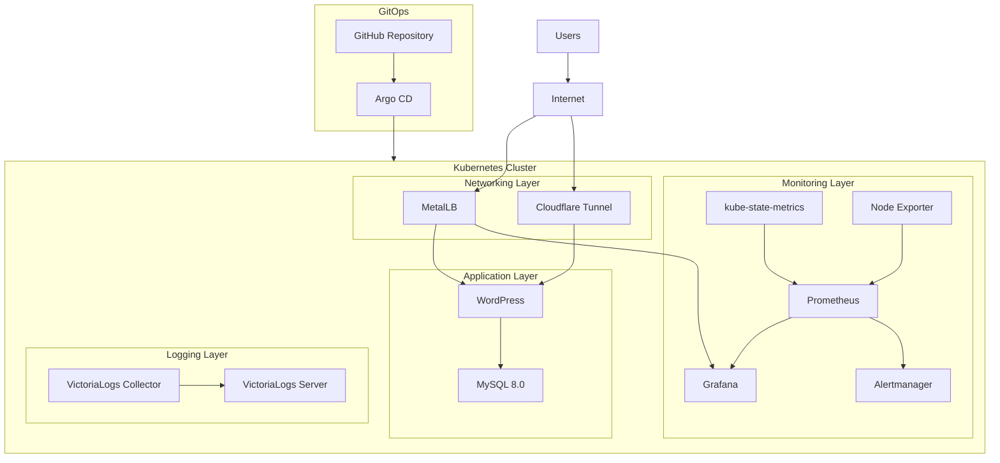
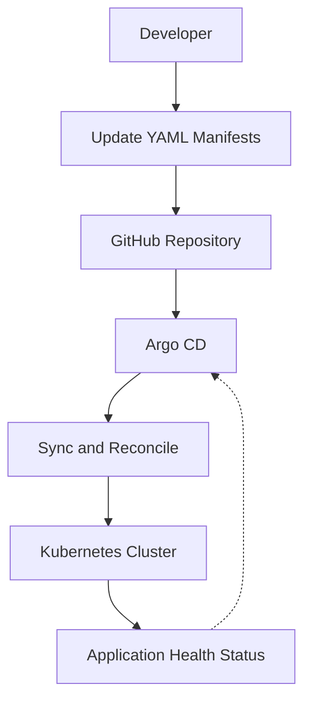
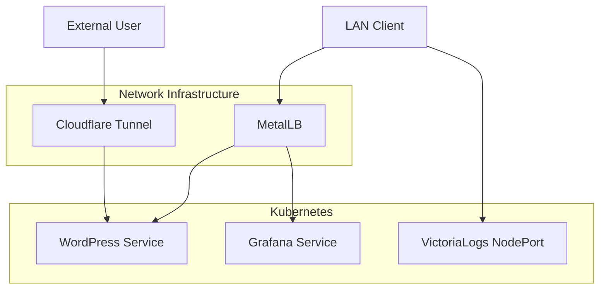
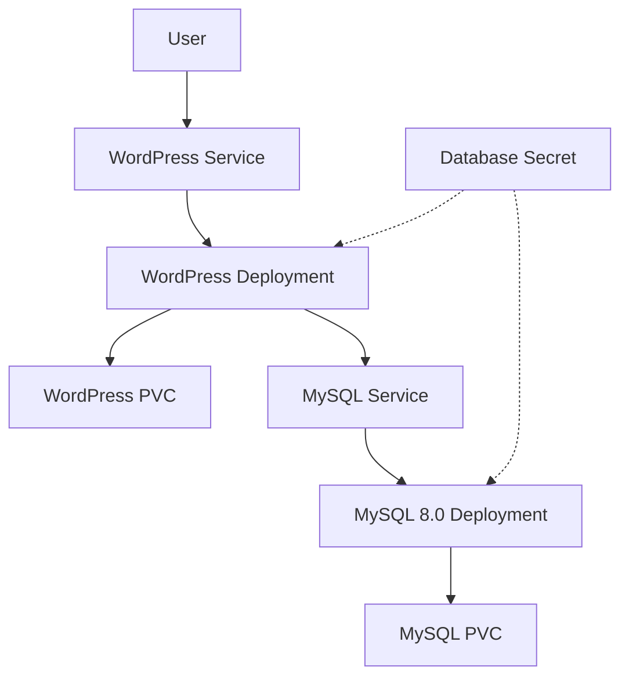
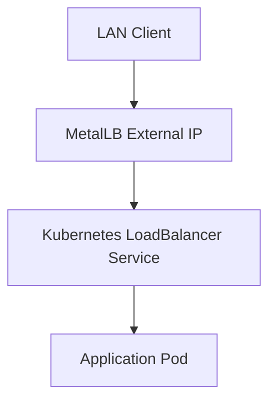
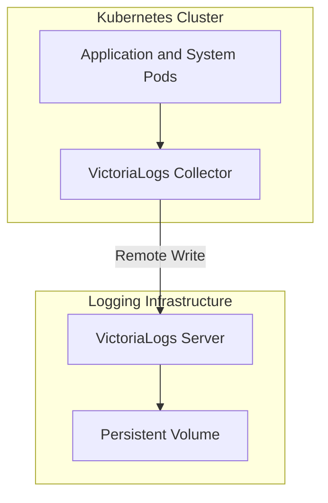

# Kubernetes GitOps Infrastructure Portfolio


A GitOps-driven infrastructure portfolio running on a self-managed multi-node Kubernetes cluster.

This project demonstrates practical implementation of Kubernetes, Argo CD, Helm, bare-metal networking, application deployment, monitoring, and centralized logging.

Git is the source of truth for infrastructure resources managed by Argo CD.

---

## Table of Contents

- [1. Project Overview](#1-project-overview)
- [2. Architecture](#2-architecture)
- [3. Repository Structure](#3-repository-structure)
- [4. GitOps Configuration](#4-gitops-configuration)
- [5. Application and Infrastructure](#5-application-and-infrastructure)
- [6. Network Exposure](#6-network-exposure)
- [7. Namespace Organization](#7-namespace-organization)
- [8. Operations and Troubleshooting](#8-operations-and-troubleshooting)
- [9. Troubleshooting Exercise](#9-troubleshooting-exercise)
- [10. Security Considerations](#10-security-considerations)
- [11. Deployment Status](#11-deployment-status)
- [12. Future Improvements](#12-future-improvements)
- [13. Author](#13-author)

---

## 1. Project Overview

This project is a collection of infrastructure services and applications running on a self-managed Kubernetes cluster.

### Platform Components

| Component | Purpose |
|---|---|
| Kubernetes | Container orchestration |
| Argo CD | GitOps continuous delivery |
| Helm | Application packaging and deployment |
| WordPress | Self-hosted web application |
| MySQL 8.0 | WordPress database |
| MetalLB | Bare-metal LoadBalancer |
| Prometheus | Metrics collection |
| Grafana | Monitoring dashboards |
| kube-state-metrics | Kubernetes state metrics |
| Node Exporter | Host-level metrics |
| Alertmanager | Alert management |
| VictoriaLogs | Centralized log storage |
| VictoriaLogs Collector | Log collection and forwarding |
| Cloudflare Tunnel | External connectivity |

### Project Objectives

- Operate a multi-node Kubernetes environment.
- Manage infrastructure declaratively through Git.
- Implement continuous reconciliation using Argo CD.
- Deploy applications using Helm.
- Expose services using MetalLB.
- Monitor cluster health and performance.
- Centralize Kubernetes logs.
- Practice infrastructure troubleshooting and operations.

---

## 2. Architecture

### 2.1 High-Level Infrastructure Architecture

The following diagram illustrates the main platform components.



### 2.2 GitOps Deployment Workflow

Argo CD monitors the Git repository and reconciles the Kubernetes cluster with the desired state defined in Git.



The main GitOps configuration is defined in `portfolio-apps.yaml`.

| Setting | Description |
|---|---|
| Automated Sync | Applies changes from Git |
| Prune | Removes resources deleted from Git |
| Self-Heal | Reconciles manual cluster changes |
| CreateNamespace | Creates destination namespaces when configured |

### 2.3 Network and Service Exposure

The following diagram illustrates how LAN clients and external users access the applications.



The actual Cloudflare public hostname and tunnel ingress routing are configured outside the Deployment manifest.

---

## 3. Repository Structure

```text
argocd-gitops-portfolio/
├── README.md
├── portfolio-apps.yaml
├── prometheus-argocd-app.yaml
├── broken-pod.yaml
└── manifests/
    ├── cloudflared-deployment.yaml
    ├── grafana-lb-service.yaml
    ├── metallb-config.yaml
    ├── victoria-logs-collector.yaml
    ├── victoria-logs-nodeport.yaml
    ├── victoria-logs-server.yaml
    └── wordpress-stack.yaml
```

### 3.1 Root-Level Manifests

| File | Purpose |
|---|---|
| `portfolio-apps.yaml` | Main Argo CD Application |
| `prometheus-argocd-app.yaml` | Prometheus Helm deployment |
| `broken-pod.yaml` | Troubleshooting exercise |
| `README.md` | Project documentation |

### 3.2 Application Manifests

| File | Resource | Purpose |
|---|---|---|
| `cloudflared-deployment.yaml` | Deployment | Cloudflare Tunnel connectors |
| `grafana-lb-service.yaml` | Service | Grafana LoadBalancer |
| `metallb-config.yaml` | IPAddressPool / L2Advertisement | MetalLB configuration |
| `victoria-logs-collector.yaml` | Argo CD Application | Collector Helm deployment |
| `victoria-logs-nodeport.yaml` | Service | VictoriaLogs NodePort |
| `victoria-logs-server.yaml` | Argo CD Application | Server Helm deployment |
| `wordpress-stack.yaml` | PVC / Deployment / Service | WordPress and MySQL |

---

## 4. GitOps Configuration

### 4.1 Main Argo CD Application


File: `portfolio-apps.yaml`

| Configuration | Value |
|---|---|
| Application name | portfolio-apps |
| Namespace | argocd |
| Repository | https://github.com/david-daisuke/argocd-gitops-portfolio.git |
| Target revision | main |
| Manifest path | manifests |
| Destination namespace | default |
| Automated sync | Enabled |
| Prune | Enabled |
| Self-heal | Enabled |

Argo CD monitors the `manifests/` directory and automatically reconciles the cluster when changes are pushed to Git.

### 4.2 Monitoring Stack Application


File: `prometheus-argocd-app.yaml`

| Configuration | Value |
|---|---|
| Application name | portfolio-monitoring-stack |
| Helm repository | prometheus-community.github.io/helm-charts |
| Chart | kube-prometheus-stack |
| Chart version | 62.7.0 |
| Namespace | monitoring |
| Automated sync | Enabled |
| Prune | Enabled |
| Self-heal | Enabled |

### 4.3 VictoriaLogs Applications

VictoriaLogs Server and Collector are managed as separate Argo CD Applications.


This separation allows independent deployment and lifecycle management.

---

## 5. Application and Infrastructure

### 5.1 WordPress and MySQL

WordPress runs with a separate MySQL 8.0 database.

Configuration file: `manifests/wordpress-stack.yaml`



| Resource | Name | Configuration |
|---|---|---|
| PVC | wp-mysql-pvc | 10Gi, ReadWriteOnce |
| Deployment | wordpress-mysql | MySQL 8.0 |
| Service | wordpress-mysql-service | TCP 3306 |
| PVC | wp-content-pvc | 10Gi, ReadWriteOnce |
| Deployment | wordpress | WordPress container |
| Service | wordpress-service | LoadBalancer, TCP 80 |
| Secret | wp-db-secret | Database credentials |

WordPress connects to MySQL through the internal Kubernetes Service `wordpress-mysql-service`.

PersistentVolumeClaims provide storage for database and WordPress content.

### 5.2 MetalLB

MetalLB provides LoadBalancer functionality for this bare-metal Kubernetes environment.

Configuration file: `manifests/metallb-config.yaml`

| Resource | Name | Value |
|---|---|---|
| IPAddressPool | default-pool | 192.168.2.100-192.168.2.150 |
| L2Advertisement | default-l2 | Advertises the address pool |



MetalLB allocates external IP addresses to Kubernetes Services of type `LoadBalancer`.

### 5.3 Cloudflare Tunnel

The Cloudflare Tunnel connector is deployed in the monitoring namespace.

Configuration file: `manifests/cloudflared-deployment.yaml`

| Setting | Value |
|---|---|
| Deployment | cloudflared |
| Replicas | 2 |
| Container image | cloudflare/cloudflared:latest |
| Tunnel mode | tunnel --no-autoupdate run |
| Authentication | Kubernetes Secret cloudflared-secret |
| Secret key | tunnel-token |
| CPU request | 100m |
| Memory request | 128Mi |
| CPU limit | 300m |
| Memory limit | 256Mi |

The tunnel token is referenced from a Kubernetes Secret rather than being embedded directly in the Deployment manifest.

### 5.4 Prometheus and Grafana

The monitoring stack is deployed using the Prometheus Community `kube-prometheus-stack` Helm chart.

Configuration file: `prometheus-argocd-app.yaml`

| Component | Purpose |
|---|---|
| Prometheus | Collects and stores metrics |
| Grafana | Visualizes metrics |
| Alertmanager | Handles alert notifications |
| kube-state-metrics | Exposes Kubernetes object state |
| Node Exporter | Exposes host-level metrics |
| Prometheus Operator | Manages Prometheus resources |

Helm configuration:

| Setting | Value |
|---|---|
| Repository | https://prometheus-community.github.io/helm-charts |
| Chart | kube-prometheus-stack |
| Version | 62.7.0 |
| Namespace | monitoring |

Grafana is exposed through `manifests/grafana-lb-service.yaml`.

The Service uses type `LoadBalancer` and forwards TCP port 80 to Grafana's container port 3000.

### 5.5 VictoriaLogs

VictoriaLogs provides centralized log storage.

The deployment is divided into two Argo CD-managed Helm Applications:

- VictoriaLogs Server
- VictoriaLogs Collector

#### VictoriaLogs Server

Configuration file: `manifests/victoria-logs-server.yaml`

| Setting | Value |
|---|---|
| Helm chart | victoria-logs-single |
| Chart version | 0.13.10 |
| Release name | vls |
| Namespace | logging |
| Retention period | 7 days |
| Storage class | local-path |
| Persistent storage | 10Gi |
| Memory limit | 1Gi |

#### VictoriaLogs Collector

Configuration file: `manifests/victoria-logs-collector.yaml`

| Setting | Value |
|---|---|
| Helm chart | victoria-logs-collector |
| Chart version | 0.3.7 |
| Release name | vlc |
| Namespace | logging |
| Destination | VictoriaLogs Server |
| CPU request | 100m |
| Memory request | 128Mi |
| CPU limit | 300m |
| Memory limit | 256Mi |

The collector forwards logs to the server using the following internal Kubernetes Service URL:

```text
http://vls-victoria-logs-single-server.logging.svc.cluster.local:9428
```

The `victoria-logs-nodeport.yaml` manifest exposes the VictoriaLogs Server on NodePort 30428.

#### Log Collection Architecture



---

## 6. Network Exposure

The repository defines several ways to access applications.

| Application | Kubernetes Service | Port |
|---|---|---|
| WordPress | LoadBalancer | 80 |
| Grafana | LoadBalancer | 80 |
| VictoriaLogs | NodePort | 30428 |

MetalLB provides LoadBalancer IP allocation for services in the bare-metal cluster.

Cloudflare Tunnel provides an additional external connectivity path.

The actual public hostname and tunnel ingress routing are configured outside the Deployment manifest.

---

## 7. Namespace Organization

| Namespace | Components |
|---|---|
| argocd | Argo CD |
| default | WordPress and MySQL |
| monitoring | Prometheus, Grafana, Alertmanager, Cloudflare Tunnel |
| logging | VictoriaLogs Server and Collector |
| metallb-system | MetalLB |
| kube-system | Kubernetes system components |
| local-path-storage | Local Path Provisioner |

---

## 8. Operations and Troubleshooting

The following commands are useful when operating and troubleshooting the platform.

### 8.1 Check Cluster Nodes

```bash
kubectl get nodes -o wide
NAME          STATUS   ROLES           AGE     VERSION   INTERNAL-IP    EXTERNAL-IP   OS-IMAGE             KERNEL-VERSION     CONTAINER-RUNTIME
k8s-control   Ready    control-plane   4d15h   v1.30.0   192.168.2.13   <none>        Ubuntu 26.04.1 LTS   7.0.0-42-generic   containerd://2.2.2
k8s-worker1   Ready    <none>          4d15h   v1.30.0   192.168.2.14   <none>        Ubuntu 26.04.1 LTS   7.0.0-42-generic   containerd://2.2.2
k8s-worker2   Ready    <none>          4d15h   v1.30.0   192.168.2.15   <none>        Ubuntu 26.04.1 LTS   7.0.0-42-generic   containerd://2.2.2
```

### 8.2 Check Namespaces

```bash
kubectl get namespaces
NAME                 STATUS   AGE
argocd               Active   4d1h
default              Active   4d15h
kube-node-lease      Active   4d15h
kube-public          Active   4d15h
kube-system          Active   4d15h
local-path-storage   Active   42h
logging              Active   22h
metallb-system       Active   2d2h
monitoring           Active   2d18h
```

### 8.3 Check All Pods

```bash
kubectl get pods -A -o wide
NAMESPACE            NAME                                                             READY   STATUS    RESTARTS       AGE     IP                NODE          NOMINATED NODE   READINESS GATES
argocd               argocd-application-controller-0                                  1/1     Running   0              4d1h    192.168.194.69    k8s-worker1   <none>           <none>
argocd               argocd-applicationset-controller-5785d5b967-8fwzn                1/1     Running   0              4d1h    192.168.194.68    k8s-worker1   <none>           <none>
argocd               argocd-dex-server-5768568bf-5m67k                                1/1     Running   0              4d1h    192.168.126.3     k8s-worker2   <none>           <none>
argocd               argocd-notifications-controller-5bc9bdb564-2jhc9                 1/1     Running   0              4d1h    192.168.126.1     k8s-worker2   <none>           <none>
argocd               argocd-redis-54b57dd6f-gkm8m                                     1/1     Running   0              4d1h    192.168.126.2     k8s-worker2   <none>           <none>
argocd               argocd-repo-server-657c676d87-sc4vb                              1/1     Running   0              2d18h   192.168.194.70    k8s-worker1   <none>           <none>
argocd               argocd-server-75f5bcb8c7-86zqm                                   1/1     Running   12 (11h ago)   4d1h    192.168.126.4     k8s-worker2   <none>           <none>
default              wordpress-7df88cbbb4-8xg7x                                       1/1     Running   0              42h     192.168.126.19    k8s-worker2   <none>           <none>
```

### 8.4 Check Services

```bash
kubectl get services -A
NAMESPACE        NAME                                                  TYPE           CLUSTER-IP       EXTERNAL-IP     PORT(S)                        AGE
argocd           argocd-application-controller                         ClusterIP      None             <none>          <none>                         4d1h
argocd           argocd-applicationset-controller                      ClusterIP      10.96.153.81     <none>          7000/TCP,8080/TCP              4d1h
argocd           argocd-dex-server                                     ClusterIP      10.103.236.196   <none>          5556/TCP,5557/TCP,5558/TCP     4d1h
argocd           argocd-metrics                                        ClusterIP      10.103.169.140   <none>          8082/TCP                       4d1h
argocd           argocd-notifications-controller-metrics               ClusterIP      10.100.6.138     <none>          9001/TCP                       4d1h
```

### 8.5 Check PersistentVolumeClaims

```bash
kubectl get pvc -A
NAMESPACE   NAME                                              STATUS   VOLUME                                     CAPACITY   ACCESS MODES   STORAGECLASS   VOLUMEATTRIBUTESCLASS   AGE
default     wp-content-pvc                                    Bound    pvc-d1f1ca72-fbe9-4e63-a14b-18514575b776   10Gi       RWO            local-path     <unset>                 42h
default     wp-mysql-pvc                                      Bound    pvc-74b99715-d423-484a-a542-8178f7b1da00   10Gi       RWO            local-path     <unset>                 42h
logging     server-volume-vls-victoria-logs-single-server-0   Bound    pvc-dd91d99c-f5c1-43a3-8569-810072cd189c   10Gi       RWO            local-path     <unset>                 22h
```

### 8.6 Check Argo CD Applications

```bash
kubectl get applications -n argocd
kubectl get applications -n argocd
NAME                         SYNC STATUS   HEALTH STATUS
portfolio-apps               Synced        Healthy
portfolio-monitoring-stack   Synced        Healthy
victoria-logs-collector      Synced        Healthy
victoria-logs-server         Synced        Healthy
```

### 8.7 Inspect an Argo CD Application

```bash
kubectl describe application portfolio-apps -n argocd
Name:         portfolio-apps
Namespace:    argocd
Labels:       <none>
Annotations:  <none>
API Version:  argoproj.io/v1alpha1
Kind:         Application
Metadata:
  Creation Timestamp:  2026-11-08T06:49:58Z
  Generation:          948
  Resource Version:    627429
  UID:                 e4111272-fbcb-4dba-9c21-b4d88237e4c2
```

### 8.8 Inspect Pod Events

```bash
kubectl describe pod <pod-name> -n <namespace>
```

### 8.9 Check Recent Events

```bash
kubectl get events -A --sort-by=.metadata.creationTimestamp
```

---

## 9. Troubleshooting Exercise

The repository includes `broken-pod.yaml`, an intentionally misconfigured Pod manifest.

It uses an invalid Nginx image tag:

```yaml
image: nginx:typo-version
```

This manifest is stored outside the `manifests/` directory and is not automatically deployed by the main Argo CD Application.

It can be used to practice identifying image pull failures.

### 9.1 Deploy the Test Pod

```bash
kubectl apply -f broken-pod.yaml
```

### 9.2 Inspect the Pod

```bash
kubectl get pods
kubectl describe pod broken-nginx
```

### 9.3 Inspect Events

```bash
kubectl get events --sort-by=.metadata.creationTimestamp
```

The invalid image tag should result in an image pull failure.

### 9.4 Clean Up

```bash
kubectl delete -f broken-pod.yaml
```

---

## 10. Security Considerations

This repository is a personal infrastructure portfolio and learning environment. It should not be considered production-ready without further security and reliability work.

Recommended improvements:

- Store credentials in Kubernetes Secrets or an external secret manager.
- Never commit passwords, API tokens, or tunnel credentials to Git.
- Avoid default or easily guessed passwords.
- Pin container images to specific versions or digests instead of relying on `latest`.
- Configure resource requests and limits for all workloads.
- Restrict access to administrative services.
- Configure backups and recovery procedures for persistent data.
- Consider high availability and storage replication.
- Review TLS configuration for externally accessible services.

**Important:** Review `prometheus-argocd-app.yaml` before making this repository public. If it contains a hardcoded Grafana password, replace it with a secure Secret-based approach.

Do not commit actual credentials to the repository.

---

## 11. Deployment Status

The following Argo CD Applications were observed in the cluster during the documentation update.

| Application | Sync Status | Health Status |
|---|---|---|
| portfolio-apps | Synced | Healthy |
| portfolio-monitoring-stack | Synced | Healthy |
| victoria-logs-collector | Synced | Healthy |
| victoria-logs-server | Synced | Healthy |

These statuses describe the cluster at the time of documentation and may change as the infrastructure evolves.

---

## 12. Future Improvements

Potential future enhancements:

- Add automated Kubernetes manifest validation.
- Introduce Kustomize overlays for environment-specific configuration.
- Add CI workflows using GitHub Actions.
- Implement automated backup and restore testing.
- Add Grafana dashboards and alert rules.
- Improve secrets management.
- Add network policies and workload security controls.
- Document disaster recovery procedures.

---

## 13. Author

**David Daisuke**

GitHub: [david-daisuke](https://github.com/david-daisuke)

This repository demonstrates hands-on experience with Kubernetes, GitOps, Argo CD, Helm, observability, networking, and self-hosted applications.
