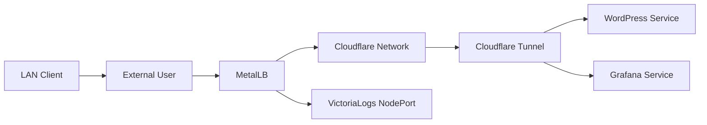
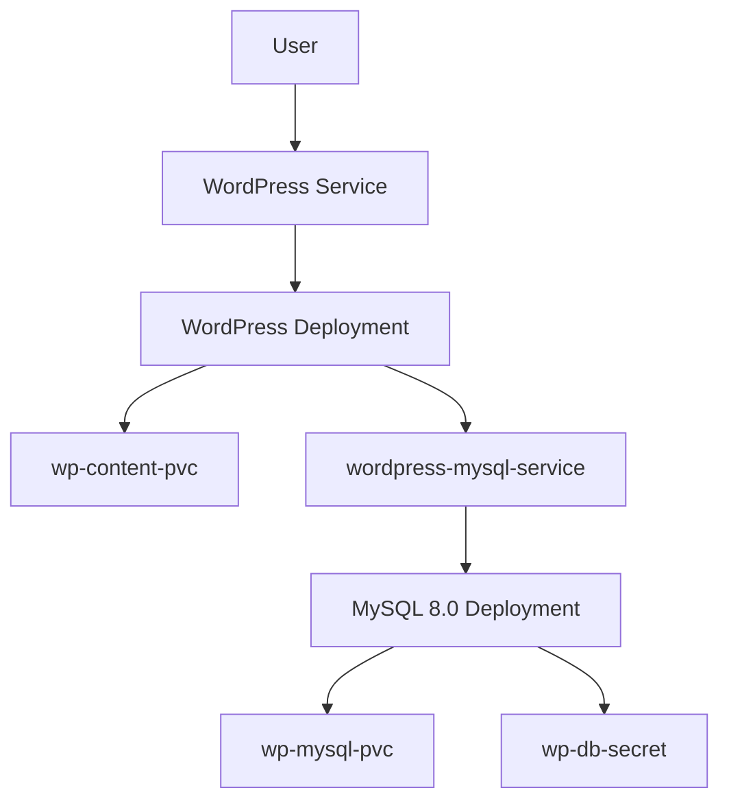
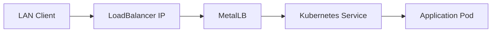
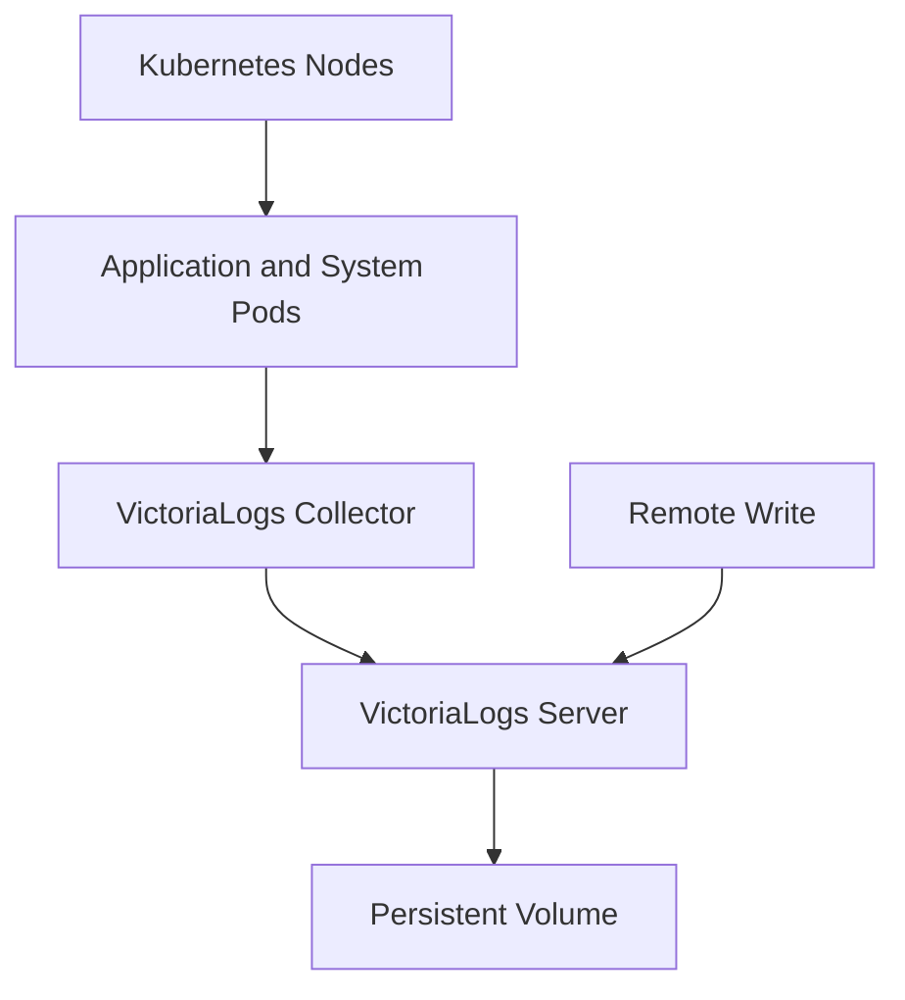

# Kubernetes GitOps Infrastructure Portfolio

<p align="center">
  <strong>A Self-Hosted Kubernetes Platform Managed with Argo CD, GitOps, Helm, and Observability Tools</strong>
</p>

<p align="center">
  
  
  
  
  
  
</p>

---

## 1. Project Overview

This repository contains the declarative configuration for a self-hosted Kubernetes infrastructure platform.

The primary objective is to demonstrate practical skills in:

- Kubernetes cluster administration and workload management
- GitOps-based infrastructure management with Argo CD
- Declarative application deployment using Kubernetes manifests
- Helm-based installation and lifecycle management
- Container networking and external service exposure
- Infrastructure monitoring and metrics collection
- Centralized log collection and storage
- Persistent storage for stateful applications
- Secure external connectivity using Cloudflare Tunnel

The platform runs a collection of infrastructure services and applications on a multi-node Kubernetes cluster.

The Git repository acts as the source of truth for the resources managed by Argo CD.

### Current platform components

| Component | Purpose |
|---|---|
| Kubernetes | Container orchestration platform |
| Argo CD | GitOps continuous delivery |
| Helm | Packaging and deployment of platform components |
| WordPress | Self-hosted web application |
| MySQL 8.0 | WordPress database |
| MetalLB | LoadBalancer implementation for bare-metal Kubernetes |
| Prometheus | Metrics collection and monitoring |
| Grafana | Metrics visualization and dashboards |
| kube-state-metrics | Kubernetes object state metrics |
| Node Exporter | Host-level metrics |
| Alertmanager | Alert handling |
| VictoriaLogs | Centralized log storage |
| VictoriaLogs Collector | Log collection and forwarding |
| Cloudflare Tunnel | Secure external connectivity |

---

## 2. Architecture

### 2.1 High-Level Infrastructure Architecture

The following diagram illustrates the major components and their relationships.

```mermaid
flowchart TB
    USER["Users / Administrators"]
    GITHUB["GitHub Repository<br/>Source of Truth"]
    ARGO["Argo CD<br/>GitOps Controller"]

    subgraph K8S["Kubernetes Cluster"]
        subgraph APP["Application Layer"]
            WP["WordPress"]
            DB["MySQL 8.0"]
            WPVOL[("Persistent Volumes")]
            WP --> DB
            WP --> WPVOL
            DB --> WPVOL
        end

        subgraph OBS["Observability Layer"]
            PROM["Prometheus"]
            GRAF["Grafana"]
            ALERT["Alertmanager"]
            KSM["kube-state-metrics"]
            NODE["Node Exporter"]
            VLOG["VictoriaLogs Server"]
            VLC["VictoriaLogs Collector"]

            PROM --> GRAF
            PROM --> ALERT
            KSM --> PROM
            NODE --> PROM
            VLC --> VLOG
        end

        subgraph NET["Networking Layer"]
            METALLB["MetalLB"]
            LB["LoadBalancer Services"]
            TUNNEL["Cloudflare Tunnel"]
            METALLB --> LB
        end
    end

    GITHUB -->|"Git repository sync"| ARGO
    ARGO -->|"Reconciliation"| K8S

    USER --> WP
    USER --> GRAF
    LB --> WP
    LB --> GRAF
    TUNNEL --> WP

    style K8S fill:#f5f7fa,stroke:#326CE5,stroke-width:2px
    style GITHUB fill:#24292e,color:#fff
    style ARGO fill:#ef7b4d,color:#fff
    style VLOG fill:#5b6abf,color:#fff


## 2.2 GitOps Deployment Workflow

Argo CD continuously monitors the Git repository and reconciles the
Kubernetes cluster with the desired state defined in Git.

```mermaid
flowchart LR
    A[Developer] -->|git push| B[GitHub Repository]
    B -->|Repository monitoring| C[Argo CD]
    C -->|Apply desired state| D[Kubernetes API]
    D --> E[Kubernetes Resources]
    E -->|Health status| C
```

The main GitOps configuration is defined in `portfolio-apps.yaml`.

Important synchronization settings:

| Setting | Description |
|---|---|
| Automated Sync | Automatically applies changes from Git |
| Prune | Removes resources deleted from Git |
| Self-Heal | Reconciles manual cluster changes |
| CreateNamespace | Creates destination namespaces when configured |

## 2.3 Network and Service Exposure



The actual Cloudflare public hostname and ingress routing are configured
outside the Deployment manifest.

## 3. Repository Structure

```text
argocd-gitops-portfolio/
├── README.md
├── portfolio-apps.yaml
├── prometheus-argocd-app.yaml
├── broken-pod.yaml
└── manifests/
    ├── cloudflared-deployment.yaml
    ├── grafana-lb-service.yaml
    ├── metallb-config.yaml
    ├── victoria-logs-collector.yaml
    ├── victoria-logs-nodeport.yaml
    ├── victoria-logs-server.yaml
    └── wordpress-stack.yaml
```

### 3.1 Root-Level Manifests

| File | Purpose |
|---|---|
| `portfolio-apps.yaml` | Main Argo CD Application that deploys resources from the `manifests/` directory |
| `prometheus-argocd-app.yaml` | Deploys kube-prometheus-stack using Helm |
| `broken-pod.yaml` | Intentionally broken Pod manifest for troubleshooting practice |
| `README.md` | Project documentation |

### 3.2 Application Manifests

| File | Resource / Application | Purpose |
|---|---|---|
| `cloudflared-deployment.yaml` | Deployment | Runs Cloudflare Tunnel connectors |
| `grafana-lb-service.yaml` | Service | Exposes Grafana through LoadBalancer |
| `metallb-config.yaml` | IPAddressPool / L2Advertisement | Configures MetalLB address allocation |
| `victoria-logs-collector.yaml` | Argo CD Application | Deploys VictoriaLogs Collector using Helm |
| `victoria-logs-nodeport.yaml` | Service | Exposes VictoriaLogs through NodePort |
| `victoria-logs-server.yaml` | Argo CD Application | Deploys VictoriaLogs Server using Helm |
| `wordpress-stack.yaml` | PVCs / Deployments / Services | Deploys WordPress and MySQL |

## 4. GitOps Configuration

### 4.1 Main Argo CD Application

File: `portfolio-apps.yaml`

This manifest defines the main Argo CD Application.

| Configuration | Value |
|---|---|
| Application name | portfolio-apps |
| Namespace | argocd |
| Repository | https://github.com/david-daisuke/argocd-gitops-portfolio.git |
| Target revision | main |
| Manifest path | manifests |
| Destination namespace | default |
| Automated sync | Enabled |
| Prune | Enabled |
| Self-heal | Enabled |

Argo CD monitors the `manifests/` directory and automatically reconciles
the cluster when changes are pushed to the Git repository.

### 4.2 Monitoring Stack Application

File: `prometheus-argocd-app.yaml`

This Application deploys the Prometheus monitoring stack using Helm.

| Configuration | Value |
|---|---|
| Application name | portfolio-monitoring-stack |
| Helm repository | https://prometheus-community.github.io/helm-charts |
| Chart | kube-prometheus-stack |
| Chart version | 62.7.0 |
| Namespace | monitoring |
| Automated sync | Enabled |
| Prune | Enabled |
| Self-heal | Enabled |

### 4.3 VictoriaLogs Applications

VictoriaLogs Server and Collector are managed as separate Argo CD
Applications.

This separation allows independent deployment and lifecycle management.

## 5. Application and Infrastructure Details

### 5.1 WordPress and MySQL

WordPress runs with a separate MySQL 8.0 database.

Configuration file: `manifests/wordpress-stack.yaml`



Resources:

| Resource | Name | Configuration |
|---|---|---|
| PersistentVolumeClaim | wp-mysql-pvc | 10Gi, ReadWriteOnce |
| Deployment | wordpress-mysql | MySQL 8.0 |
| Service | wordpress-mysql-service | TCP 3306 |
| PersistentVolumeClaim | wp-content-pvc | 10Gi, ReadWriteOnce |
| Deployment | wordpress | WordPress container |
| Service | wordpress-service | LoadBalancer, TCP 80 |
| Secret | wp-db-secret | Database credentials |

The WordPress container connects to MySQL through the internal Kubernetes
Service `wordpress-mysql-service`.

PersistentVolumeClaims provide storage for database and WordPress content.

### 5.2 MetalLB

MetalLB provides LoadBalancer functionality for this bare-metal
Kubernetes environment.

Configuration file: `manifests/metallb-config.yaml`

| Resource | Name | Value |
|---|---|---|
| IPAddressPool | default-pool | 192.168.2.100-192.168.2.150 |
| L2Advertisement | default-l2 | Advertises the address pool |



MetalLB allocates external IP addresses to Kubernetes Services of type
`LoadBalancer`.

### 5.3 Cloudflare Tunnel

The Cloudflare Tunnel connector is deployed in the monitoring namespace.

Configuration file: `manifests/cloudflared-deployment.yaml`

| Setting | Value |
|---|---|
| Deployment | cloudflared |
| Replicas | 2 |
| Container image | cloudflare/cloudflared:latest |
| Tunnel mode | tunnel --no-autoupdate run |
| Authentication | Kubernetes Secret cloudflared-secret |
| Secret key | tunnel-token |
| CPU request | 100m |
| Memory request | 128Mi |
| CPU limit | 300m |
| Memory limit | 256Mi |

The tunnel token is referenced from a Kubernetes Secret rather than
being embedded directly in the Deployment manifest.

### 5.4 Prometheus and Grafana

The monitoring stack is deployed using the Prometheus Community
kube-prometheus-stack Helm chart.

Configuration file: `prometheus-argocd-app.yaml`

| Component | Purpose |
|---|---|
| Prometheus | Collects and stores metrics |
| Grafana | Visualizes metrics in dashboards |
| Alertmanager | Handles alert notifications |
| kube-state-metrics | Exposes Kubernetes object state metrics |
| Node Exporter | Exposes node-level operating system metrics |
| Prometheus Operator | Manages Prometheus-related resources |

Helm chart:

| Setting | Value |
|---|---|
| Repository | https://prometheus-community.github.io/helm-charts |
| Chart | kube-prometheus-stack |
| Version | 62.7.0 |
| Namespace | monitoring |

Grafana is exposed through the Service defined in
`manifests/grafana-lb-service.yaml`.

The Service uses type LoadBalancer and forwards TCP port 80 to
Grafana's container port 3000.

### 5.5 VictoriaLogs

VictoriaLogs provides centralized log storage.

The deployment is divided into two Argo CD-managed Helm Applications:

- VictoriaLogs Server
- VictoriaLogs Collector

#### VictoriaLogs Server

Configuration file: `manifests/victoria-logs-server.yaml`

| Setting | Value |
|---|---|
| Helm chart | victoria-logs-single |
| Chart version | 0.13.10 |
| Release name | vls |
| Namespace | logging |
| Retention period | 7 days |
| Storage class | local-path |
| Persistent storage | 10Gi |
| Memory limit | 1Gi |

#### VictoriaLogs Collector

Configuration file: `manifests/victoria-logs-collector.yaml`

| Setting | Value |
|---|---|
| Helm chart | victoria-logs-collector |
| Chart version | 0.3.7 |
| Release name | vlc |
| Namespace | logging |
| Destination | VictoriaLogs Server |
| CPU request | 100m |
| Memory request | 128Mi |
| CPU limit | 300m |
| Memory limit | 256Mi |

The collector forwards logs to the server using the following internal
Kubernetes Service URL:

`http://vls-victoria-logs-single-server.logging.svc.cluster.local:9428`

The `victoria-logs-nodeport.yaml` manifest exposes the VictoriaLogs
Server on NodePort 30428.

#### Log Collection Architecture



## 6. Network Exposure

The repository defines several ways to access applications.

| Application | Kubernetes Service | Port |
|---|---|---|
| WordPress | LoadBalancer | 80 |
| Grafana | LoadBalancer | 80 |
| VictoriaLogs | NodePort | 30428 |

MetalLB provides LoadBalancer IP allocation for services in the
bare-metal cluster.

Cloudflare Tunnel provides an additional external connectivity path.

The actual public hostname and tunnel ingress routing are configured
outside the Deployment manifest.

## 7. Namespace Organization

The platform uses separate namespaces to organize its components.

| Namespace | Components |
|---|---|
| argocd | Argo CD |
| default | WordPress and MySQL |
| monitoring | Prometheus, Grafana, Alertmanager, Cloudflare Tunnel |
| logging | VictoriaLogs Server and Collector |
| metallb-system | MetalLB |
| kube-system | Kubernetes system components |
| local-path-storage | Local Path Provisioner |

## 8. Operations and Troubleshooting

The following commands are useful when operating and troubleshooting
the platform.

### 8.1 Check Cluster Nodes

```bash
kubectl get nodes -o wide
```

### 8.2 Check Namespaces

```bash
kubectl get namespaces
```

### 8.3 Check All Pods

```bash
kubectl get pods -A -o wide
```

### 8.4 Check Services

```bash
kubectl get services -A
```

### 8.5 Check PersistentVolumeClaims

```bash
kubectl get pvc -A
```

### 8.6 Check Argo CD Applications

```bash
kubectl get applications -n argocd
```

### 8.7 Inspect an Argo CD Application

```bash
kubectl describe application portfolio-apps -n argocd
```

### 8.8 Inspect Pod Events

```bash
kubectl describe pod <pod-name> -n <namespace>
```

### 8.9 Check Recent Events

```bash
kubectl get events -A --sort-by=.metadata.creationTimestamp
```

## 9. Troubleshooting Exercise

The repository includes `broken-pod.yaml`, an intentionally
misconfigured Pod manifest.

It uses an invalid Nginx image tag:

```yaml
image: nginx:typo-version
```

This manifest is stored outside the `manifests/` directory and is not
automatically deployed by the main Argo CD Application.

It can be used to practice identifying image pull failures.

### 9.1 Deploy the Test Pod

```bash
kubectl apply -f broken-pod.yaml
```

### 9.2 Inspect the Pod

```bash
kubectl get pods
kubectl describe pod broken-nginx
```

### 9.3 Inspect Events

```bash
kubectl get events --sort-by=.metadata.creationTimestamp
```

The invalid image tag should result in an image pull failure.

### 9.4 Clean Up

Delete the test resource after completing the exercise:

```bash
kubectl delete -f broken-pod.yaml
```

## 10. Security and Production Considerations

This repository is a personal infrastructure portfolio and learning
environment. It should not be considered production-ready without
further security and reliability work.

Recommended improvements include:

- Store credentials in Kubernetes Secrets or an external secret manager.
- Avoid committing passwords, API tokens, and tunnel credentials to Git.
- Avoid using default or easily guessed passwords.
- Pin container images to specific versions or digests instead of
  relying on latest.
- Configure resource requests and limits for all workloads.
- Review network exposure and restrict access to administrative services.
- Configure backups and recovery procedures for persistent data.
- Consider high availability and storage replication where required.
- Review TLS configuration for externally accessible services.

**Important:** Review `prometheus-argocd-app.yaml` before making this
repository public. If it still contains a hardcoded Grafana password,
replace that configuration with a secure Secret-based approach.

Do not commit actual credentials to the repository.

## 11. Current Deployment Status

The following Argo CD Applications were observed in the cluster during
the documentation update.

| Application | Sync Status | Health Status |
|---|---|---|
| portfolio-apps | Synced | Healthy |
| portfolio-monitoring-stack | Synced | Healthy |
| victoria-logs-collector | Synced | Healthy |
| victoria-logs-server | Synced | Healthy |

These statuses describe the cluster at the time of documentation and
may change as the infrastructure evolves.

## 12. Future Improvements

Potential future enhancements for this project include:

- Add automated validation of Kubernetes manifests.
- Introduce Kustomize overlays for environment-specific configuration.
- Add CI workflows using GitHub Actions.
- Implement automated backup and restore testing.
- Add more Grafana dashboards and alert rules.
- Improve secrets management.
- Add network policies and workload security controls.
- Document disaster recovery procedures.

## 13. Author

David Daisuke

GitHub: david-daisuke

This repository demonstrates hands-on experience with Kubernetes,
GitOps, Argo CD, Helm, observability, networking, and self-hosted
applications.

